# Vhordo: Chordo fork
Vhordo is a [Chordo](https://github.com/ChurchApps/Chordo) fork that aims to bring GitHub integration and add some QoL features. This fork is made primary for my local church's worship team, so we can have 1 remote and synced database with just a GitHub repo. But I actually think that this fork would be useful for other worship teams too! 

### Features
- Every feature presented in [Chordo](https://github.com/ChurchApps/Chordo)
- GitHub integration. Now you can use GitHub repo as a songs and setlists source
- GitHub Pages optimization, so it would work on GitHub Pages (obviously)
- Minor QoL and visual changes

> [!IMPORTANT]
> This fork is actually very vibecoded. Yeah, I know that vibecode is not the best thing, but at least it works. Maybe somewhen I will make the same fork without using AI, but that will take at least month, since I need to learn TypeScript and make all work from scratch (by that I mean from clean Chordo). If you don't appreciate AI generated code, then that's fine, I understand you. Anyways, have a great day :)

### How to use GitHub integration
##### Step 1. Create a GitHub repo
I don't think this will be a difficult step, but still...
1. Open [GitHub's home page](https://github.com)
2. Click on '+' button, and then click 'New repository'

3. Enter repo's name and everything else if you want to (everything except name is not neccessary)
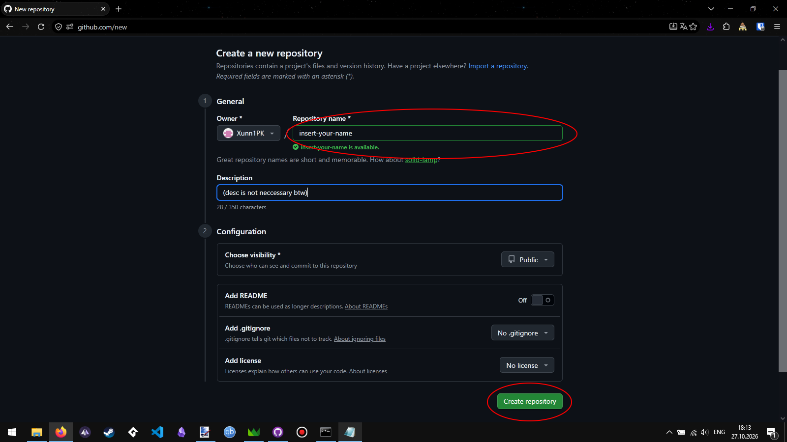

##### Step 2. Create a fine-grained PAT
1. Click on your profile picture and open settings
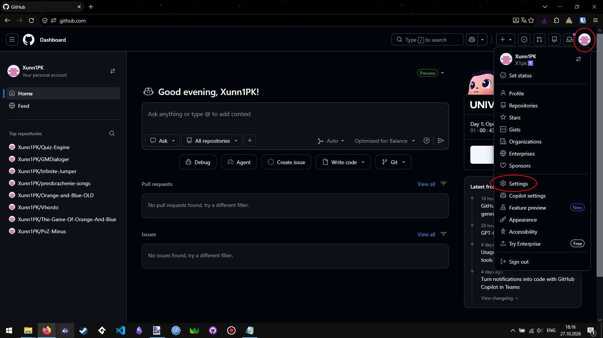
2. Scroll down to 'Developer settings'
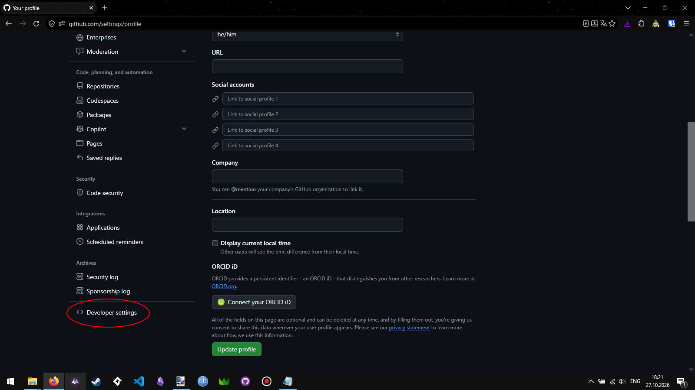
3. Click 'Personal access tokens' and select 'Fine-grained tokens'. Click generate new token. Confirm access if needed
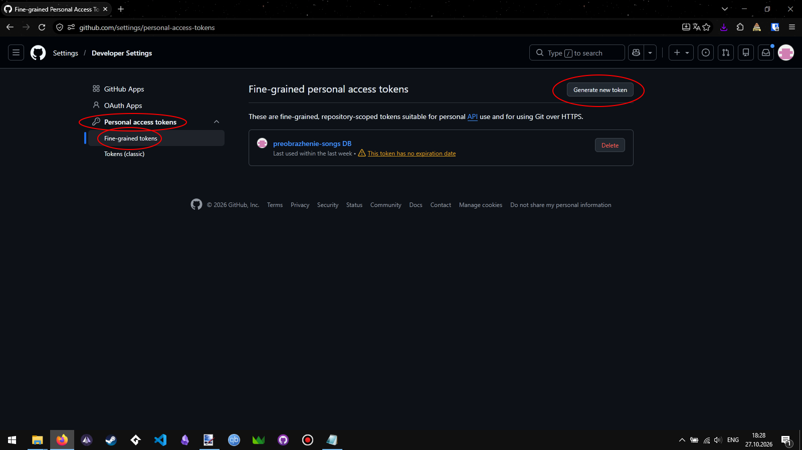
4. Enter token name, set expiration date, in 'Repository access' select 'Only select repositories' and select your repo from step 1. 
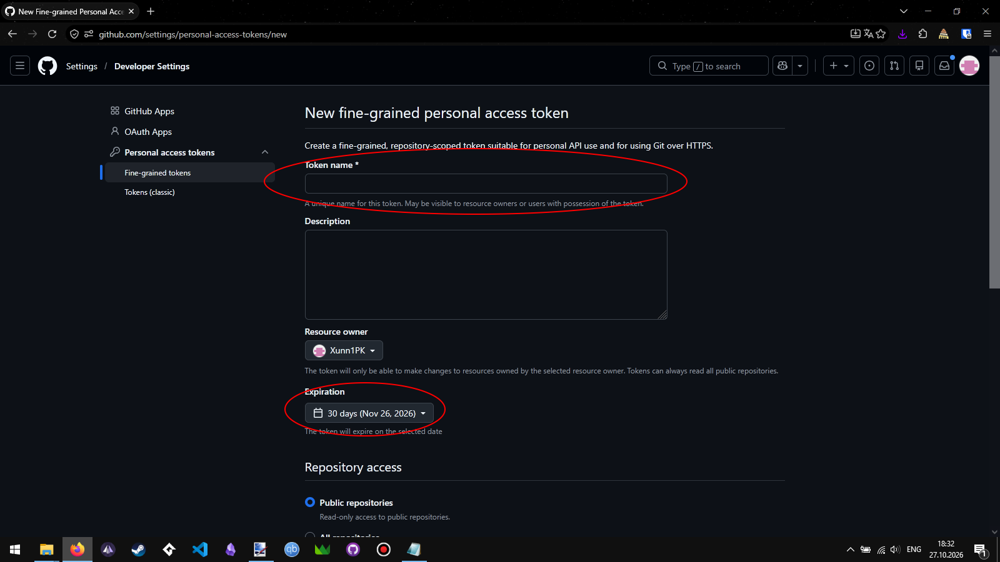
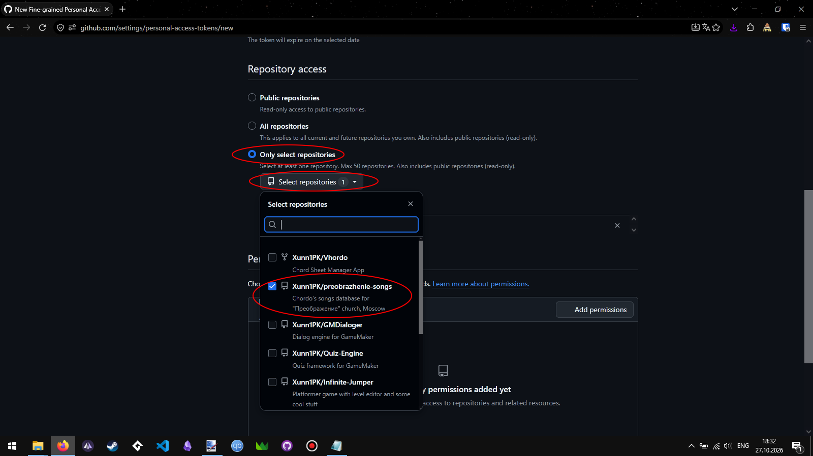
5. Add 'Contents' read-and-write permission and click 'Generate token'. Then click 'Generate token' again
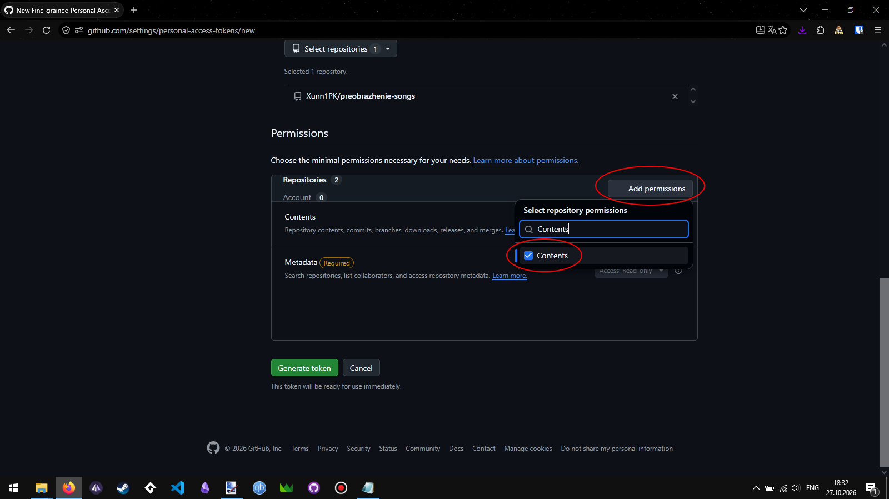
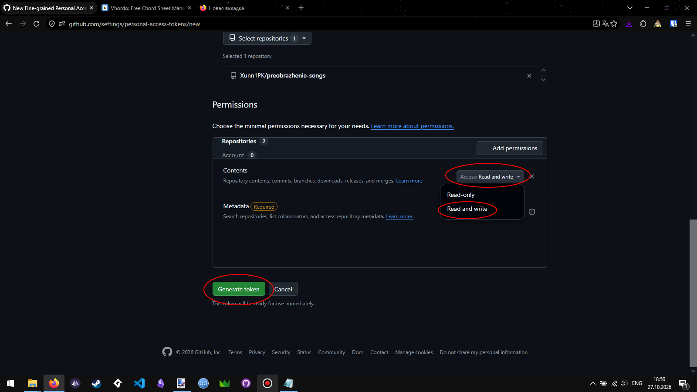
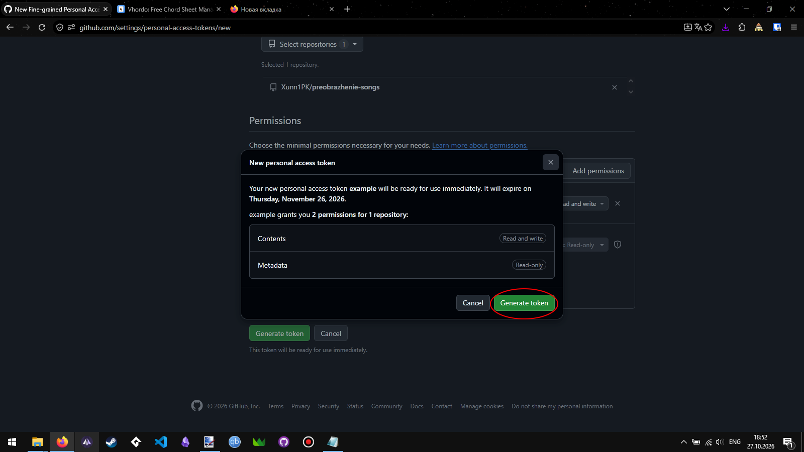
6. Copy token and store it in safe place, because you will never able to see it again
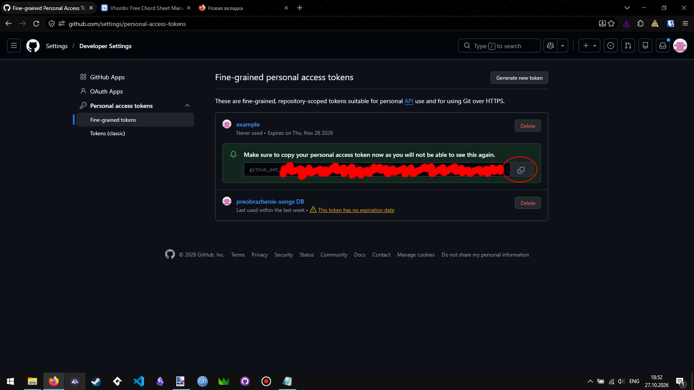

##### Step 3. Setup GitHub integration in Vhordo
1. Open settings
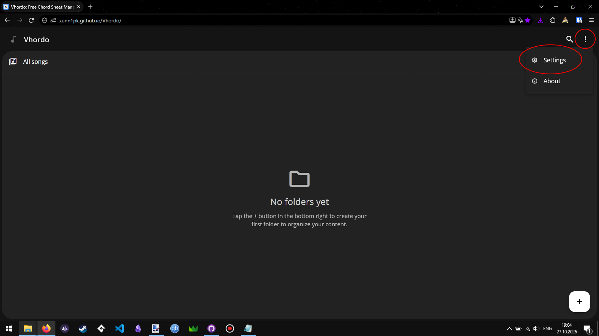
2. In 'GitHub' click 'Connect'
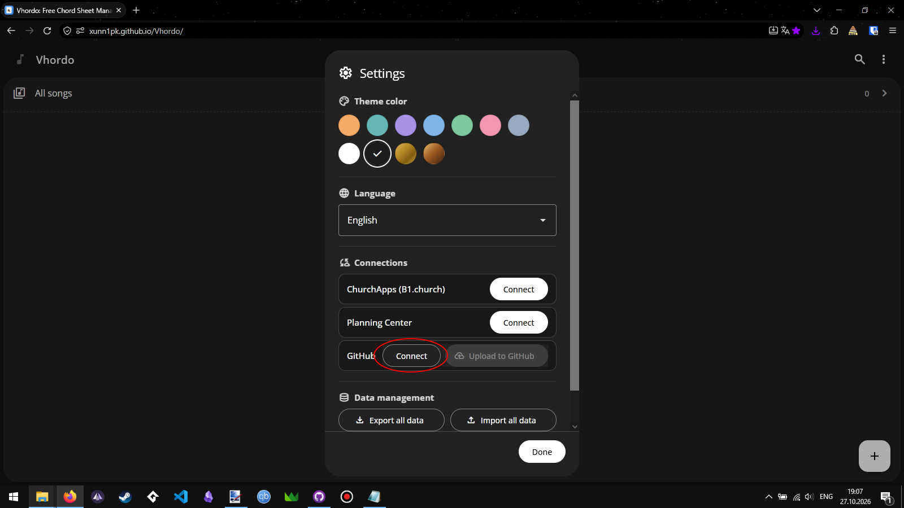
3. Enter your repo's (step 1) link and access token (step 2) and click OK
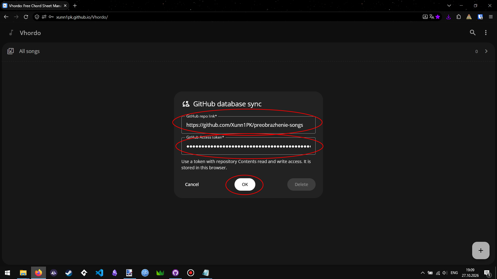
4. if there's an error, then check if you enter everything correctly
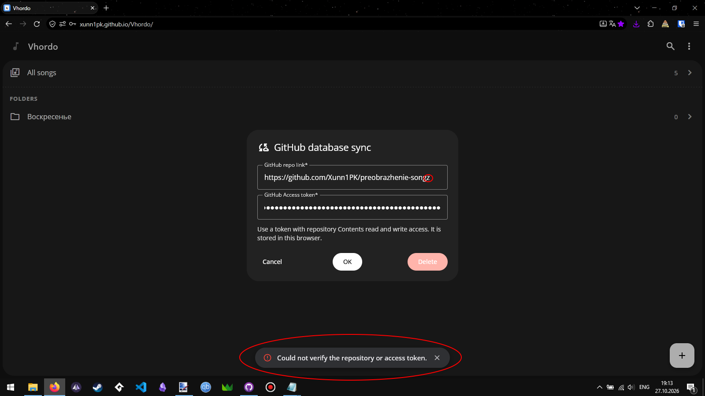

##### I hope this guide is as clear as possible, so even toddler could do this. If not, then I'm sorry, I really tried ;(

### Credits
Chordo - Kristoffer Vassbø and ChurchApps

### Run locally

- `npm install`
- `npm run dev`
